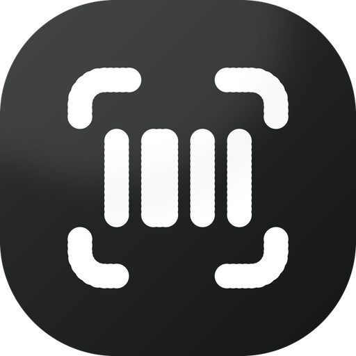
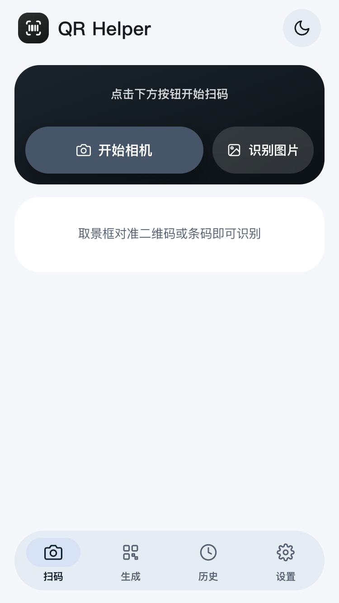
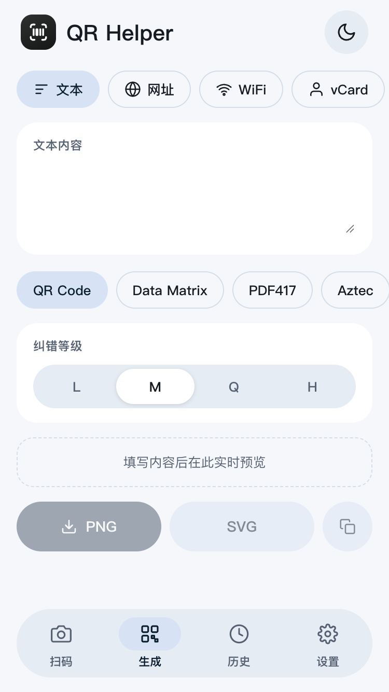
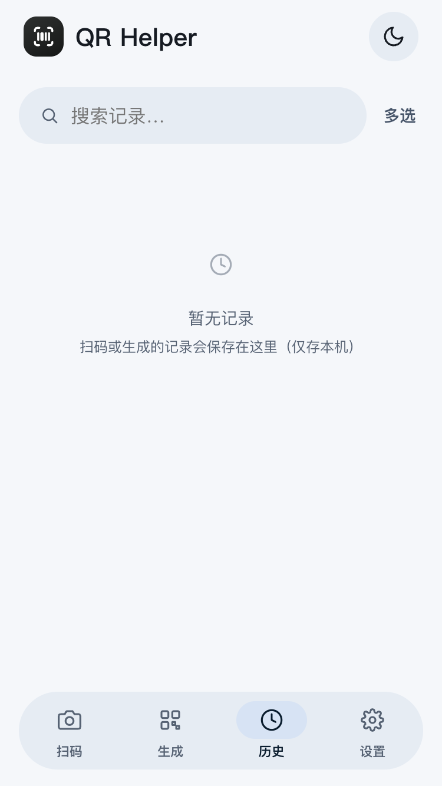
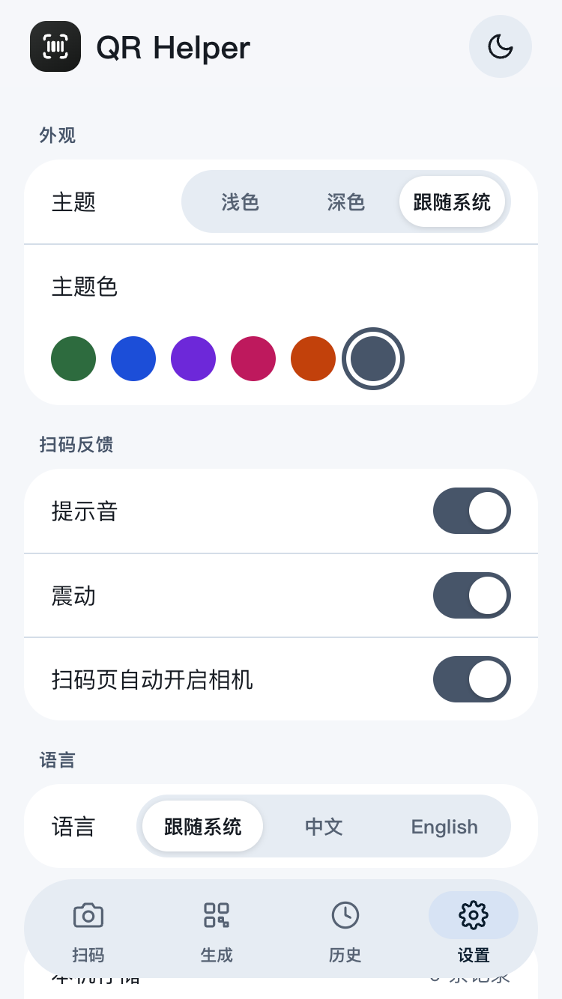
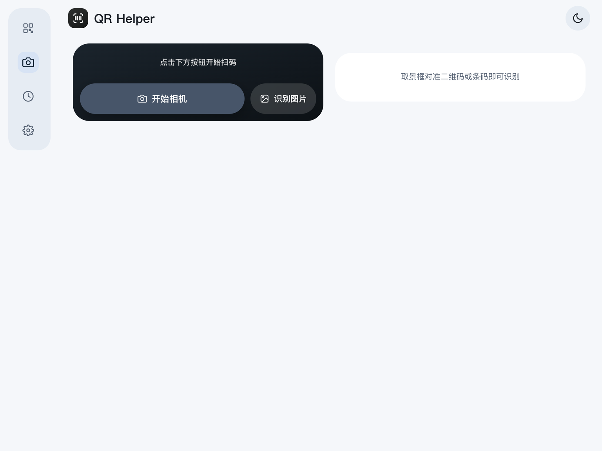
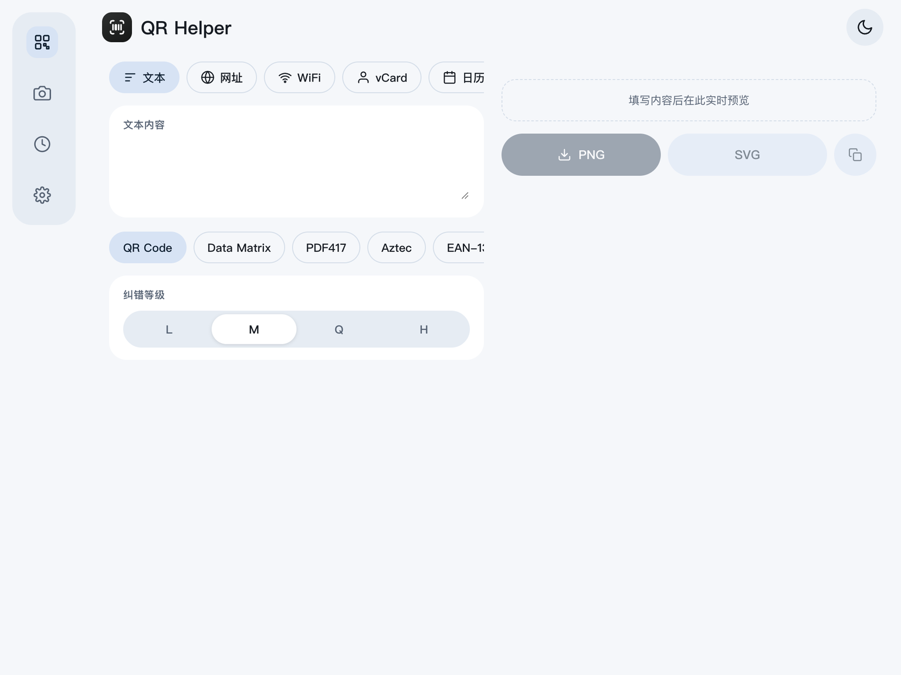
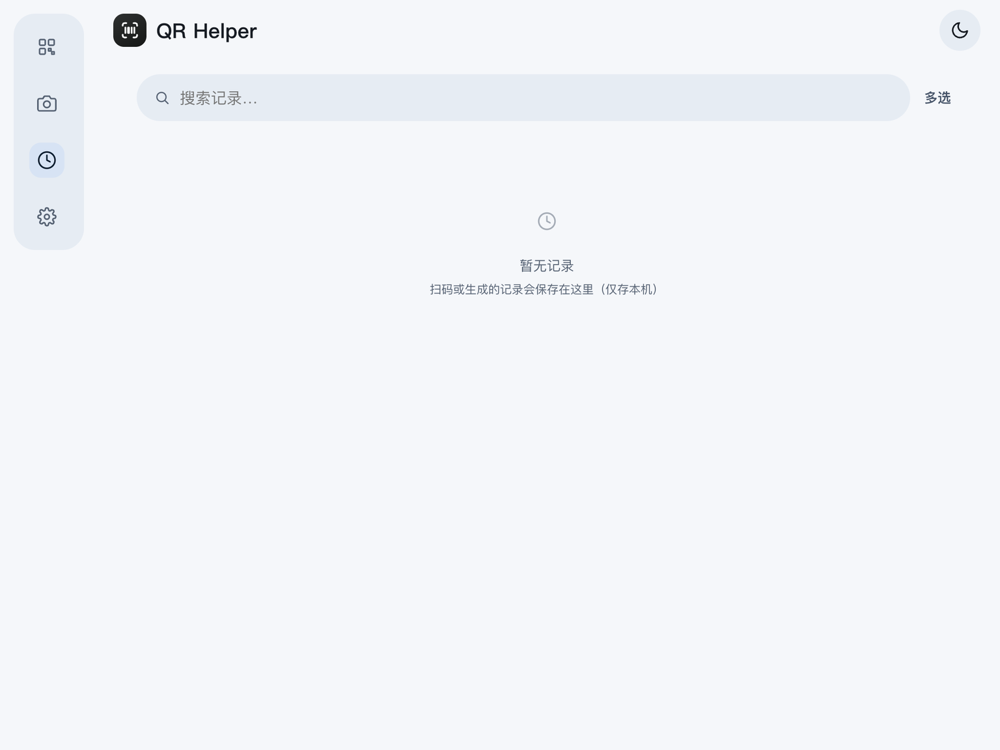
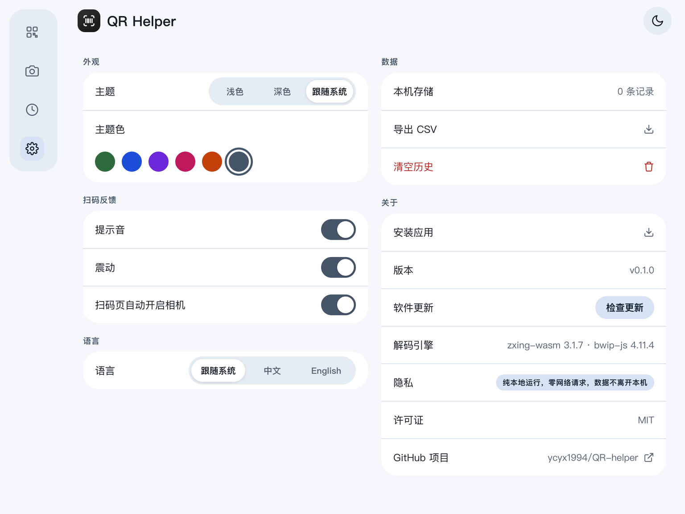

<div align="center">



# QR Helper

**全平台 PWA 二维码 / 条形码工具箱**

扫码 · 生成 · 历史 · 离线可用 —— 纯本地运行，零网络请求

[在线体验](https://ycyx1994.github.io/QR-helper/) · [功能](#-功能) · [开发](#-开发) · [部署](#-部署到-github-pages) · [隐私](#-隐私)

<br />


</div>

---

## ✨ 功能

### 📷 扫码

| 能力 | 说明 |
| --- | --- |
| 摄像头实时扫码 | zxing-wasm 解码，Web Worker 运行不阻塞 UI |
| 图片识别 | 拖拽 / 粘贴 / 选择文件（iOS 相机受限时的兜底） |
| 闪光灯 | 支持 torch 的设备自动显示开关 |
| 智能动作 | 开网址 · 拨号 · 发邮件 · 发短信 · 下载 vCard (.vcf) · 下载日历 (.ics) · 复制 · 一键转生成 |
| 反馈 | 震动 + 提示音（可在设置关闭）；同码 2.5s 冷却防重复弹卡 |
| 自动开扫 | 相机权限已授权时自动开启（可关；PC 默认关） |

### 🧾 生成

| 能力 | 说明 |
| --- | --- |
| 8 种内容 | 文本 · 网址 · WiFi · vCard · 日历事件 · 电话 · 邮件 · 短信 |
| 13 种码制 | QR Code · Data Matrix · PDF417 · Aztec · EAN-13 · EAN-8 · UPC-A · UPC-E · Code 128 · Code 39 · Code 93 · Codabar · ITF |
| 参数 | QR 纠错 L/M/Q/H；EAN/UPC 校验位自动补全 |
| 导出 | PNG（1024px）/ SVG 矢量，一键复制内容 |

### 🕘 历史

- 最近 200 条本地记录（localStorage），搜索、多选删除、清空
- 行内快捷操作：复制 · 打开链接 · 生成该项二维码（浮层预览，PNG/SVG 下载）· 编辑再生成
- 导出 CSV（含防公式注入处理）

### ⚙️ 设置

- 外观：浅色 / 深色 / 跟随系统 + 6 组强调色（背景色调联动）
- 反馈：提示音、震动、扫码页自动开启相机
- 语言：跟随系统 / 中文 / English（含 manifest 本地化）
- 数据：存储概览 · 导出 · 清空
- 关于：安装 PWA · 软件更新（检测 + 一键触发）· 项目地址

## 📸 界面预览

**iPhone**（扫码 / 生成 / 历史 / 设置）：

<p align="center">
  
  
  
  
</p>

**iPad**（≥1024px 自动切换桌面布局：收缩侧边栏 + 双栏）：

<p align="center">
  
  
  
  
</p>

## 🌐 兼容

| 平台 | 状态 |
| --- | --- |
| Android Chrome | ✅ 全功能 |
| iOS Safari | ✅ 全功能（standalone 相机受限时用图片识别兜底） |
| 桌面浏览器 | ✅ 双栏布局，Ctrl/Cmd+V 粘贴识别 |
| 离线 | ✅ Service Worker 预缓存全部资源（含 wasm） |

> 摄像头需要 HTTPS 或 localhost 安全上下文。

## 🛠 技术栈

| 层 | 选型 |
| --- | --- |
| 框架 | Svelte 5 + TypeScript + Vite |
| 解码 | [zxing-wasm](https://github.com/Sec-ant/barcode-detector) 3.1.7（Web Worker，本地 wasm） |
| 生成 | [bwip-js](https://github.com/metafloor/bwip-js) 4.11.4（动态按需加载） |
| UI | 自研 Material 3 Expressive 组件（零 UI 框架依赖） |
| i18n | svelte-i18n（zh-CN / en） |
| PWA | vite-plugin-pwa（Workbox 预缓存） |

## 💻 开发

```bash
npm ci          # 安装
npm run dev     # 开发（http://localhost:5173）
npm test        # 往返测试：payload 构建 → 渲染 → 解码（37 项）
npm run check   # svelte-check 类型与 a11y
npm run build   # 产物在 dist/
npm run icons   # 重新生成 PWA 图标（Pillow）
```

本地 HTTPS 预览（真机调试相机）：

```bash
HTTPS=1 npm run build && HTTPS=1 npx vite preview --host 0.0.0.0 --port 4173
```

## 🚀 部署到 GitHub Pages

1. 推送到 GitHub 仓库 `main` 分支
2. 仓库 Settings → Pages → Source 选择 **GitHub Actions**
3. 推送后 `deploy.yml` 自动检查（svelte-check）、测试、构建（`PWA_BASE=/<repo>/`）、部署

本地预览产物：

```bash
npm run build && npm run preview
```

## 🗂 目录结构

```
├── src/
│   ├── lib/
│   │   ├── decoder/        # zxing-wasm Worker 解码器
│   │   ├── payloads.ts     # 8 种 payload 构建 + bwip 渲染
│   │   ├── actions.ts      # 扫码结果智能动作识别
│   │   ├── history.ts      # localStorage 历史 + CSV 导出
│   │   ├── settings.ts     # 主题 / 强调色 / 语言偏好
│   │   ├── pwa.ts          # 安装提示 + 软件更新
│   │   ├── i18n/locales/   # 中英语言包
│   │   └── ui/             # Icon / Switch / toast
│   ├── views/              # Scan / Generate / History / Settings
│   └── app.css             # Material 3 Expressive 设计令牌与组件
├── tools/                  # 图标生成 + 往返测试
└── .github/workflows/      # GitHub Pages 部署
```

## 🔒 隐私

全部处理在浏览器本地完成。**应用不发起任何网络请求**（首次加载资源除外），历史记录仅存于 localStorage，可随时导出或清空。无遥测、无第三方统计、无外部 CDN 依赖。

## 📄 许可

[MIT](LICENSE) © 2026 [ycyx1994](https://github.com/ycyx1994)
